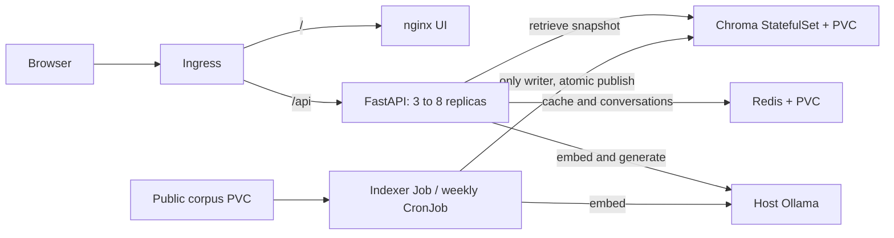

# RAHBAR architecture

The browser talks to the Ingress, which routes `/` to the static nginx UI and
`/api` to FastAPI. Three API replicas share Redis and a single read-only index
snapshot per request. The CPU HPA permits 3-8 replicas but does not measure the
host model's queue. Chroma is a one-replica StatefulSet with a stable PVC; Redis is
a Recreate Deployment so two processes do not write the same volume during rollout.

The indexer Job reads the corpus PVC, performs OCR/cleaning/chunking/embedding, and
writes a staging Chroma collection. An atomic writer lock and control-pointer
publication separate indexing from request handling. The weekly CronJob uses the
same image and configuration. Neither API startup nor an API init container indexes.

Default-deny NetworkPolicies permit only ingress-controller to UI/API, API to
Chroma/Redis, indexer to Chroma, DNS, and API/indexer to the explicitly configured
host Ollama address/port. UI-to-Chroma is denied. Redis is reachable only by API
pods in the application namespace. Corpus downloading is a developer preparation
step; the Job does not need general Internet egress.

Each application workload has its own ServiceAccount with token automount disabled,
non-root execution, read-only root filesystem, dropped capabilities, resource
budgets and an explicit temporary volume. The optional hosted-provider key comes
from an optional Secret reference, never an image or committed credential.

Liveness checks process responsiveness only. Readiness checks Redis plus a nonempty
active collection with the correct model name/dimension. Startup logs the same
checks. A mismatch stays alive but unready, as the saved canary experiment shows.
The API's rolling update has maxSurge=1, maxUnavailable=0 and a preStop drain delay.

The dev overlay targets this Windows Docker Desktop Ollama address. The prod base
requires a reachable provider endpoint and corresponding narrow network policy
for its actual environment. CI/CD generate a separate disposable fixture overlay,
substitute SHA-tagged images for CD, deploy to kind and smoke the Ingress. This
verifies the deployment artifact; it is not permanent Internet hosting.

## Measured resource budgets

The live sample in `docs/evidence/live-cluster.txt` was taken while real questions
were running. Values are observations, not a load-test capacity guarantee.

| Container | Observed CPU / memory | Request | Limit | Reason |
| --- | --- | --- | --- | --- |
| API | 36-144m / 98-121 MiB across replicas | 100m / 128 MiB | 500m / 384 MiB | Request covers the measured working set; CPU bursts can exceed the request and drive the HPA. |
| UI | 1m / 2 MiB | 25m / 32 MiB | 100m / 64 MiB | Small static server; modest startup and connection headroom. |
| Chroma | 23m / 85 MiB | 200m / 256 MiB | 1000m / 1 GiB | Serving sample is small; indexing and collection replacement need additional headroom. |
| Redis | 93m / 11 MiB | 50m / 64 MiB | 250m / 256 MiB | Small persistent cache with CPU bursts; request is a scheduling floor, not a cap. |
| Indexer | Final cgroup memory peak 246.1 MiB | 100m / 128 MiB | 1000m / 1 GiB | Offline job may burst above its request; one OCR thread matches the one-core limit. |

Indexer peak and runtime are recorded in `docs/evidence/real-indexer-final.txt`;
the earlier `kubectl top` samples are in `docs/evidence/resource-samples.json`.
The indexer and Chroma limits are conservative for document-size variation, not
measured minimum requirements. Re-measure before increasing corpus size or load.
