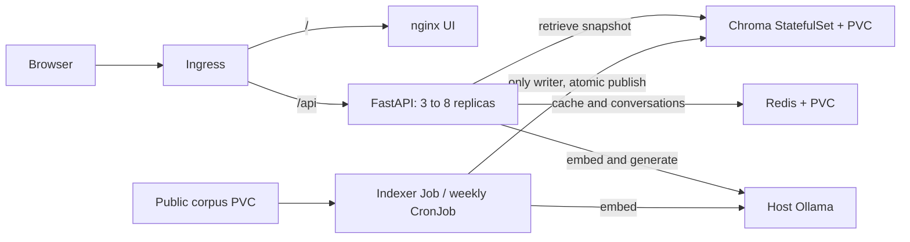

# RAHBAR: grounded university-policy answers on Kubernetes

[](https://github.com/MuhammadAbdullah8741/rahbar-rag-kubernetes/actions/workflows/ci.yml)

SCD Assignment 2 - M Abdullah and Umar Siddique. The badge reflects GitHub only
once the students push and run the workflow; it is not evidence of a completed run.

RAHBAR retrieves public FAST-NUCES policy passages, generates a short answer using
host Ollama, validates source/page citations, and abstains when evidence is missing.
The real corpus has seven documents and 161 PDF pages. CI uses a small fictional
fixture corpus and a deterministic provider so it needs no paid key or model download.
See [architecture](ARCHITECTURE.md), [corpus audit](docs/CORPUS.md),
[pipeline measurements](docs/PIPELINE.md), and [failure analysis](docs/FAILURE-ANALYSIS.md).
See [final verification and remaining submission steps](docs/FINAL-VERIFICATION.md)
for the measured checks and known answer-quality limitations.



## Reproduce on Windows with WSL Ubuntu

Run shell commands in Ubuntu. Required: Docker Desktop with WSL integration,
Python 3.12, Make, kubectl, minikube, Tesseract and Poppler. Ubuntu does not need to
be a separate operating-system installation. Keep the virtual environment inside
WSL, outside this Windows path containing spaces.
Replace the `cd` path below with your own clone location when reproducing elsewhere.

```bash
cd '/mnt/x/semester 5/SCD/A2/rahbar-starter'
export PATH="$HOME/.local/bin:$PATH"
make install VENV="$HOME/.venvs/rahbar"
make test lint VENV="$HOME/.venvs/rahbar"
make fetch VENV="$HOME/.venvs/rahbar"
make cluster
make images
```

Install/run Ollama on the Windows host, with `OLLAMA_HOST=0.0.0.0:11434` set before
starting the server. Pull `llama3.2:3b` and `nomic-embed-text:latest`. Check their
installed digests against [recorded model pins](docs/evidence/model-pins.json).
The dev overlay uses Docker Desktop's `host.docker.internal` at 192.168.65.254.
If your host uses another address, update both the hostAliases entries and the
single-IP egress NetworkPolicy in `k8s/overlays/dev` before applying.

```bash
kubectl apply -k k8s/overlays/dev
# Seed the persistent corpus volume; the Job retries while it is initially empty.
"$HOME/.venvs/rahbar/bin/python" scripts/load_corpus.py
# If an earlier empty-volume Job exhausted retries, recreate that Job only:
# kubectl delete job indexer -n rahbar
# kubectl apply -k k8s/overlays/dev
kubectl wait -n rahbar --for=condition=complete job/indexer --timeout=7200s
kubectl rollout status -n rahbar deployment/api --timeout=180s
kubectl rollout status -n rahbar deployment/ui --timeout=180s
kubectl get pods,pvc,hpa -n rahbar
```

For an existing installation, a Job's pod template is immutable. Wait for the
previous Job, then delete only `job/indexer` before reapplying changed Job settings.
Do not delete the namespace or PVCs as an update shortcut. Rebuild/load changed
images, then restart the API/UI Deployments to use a rebuilt local `dev` tag.

## Open and query the app

Leave this running in another WSL terminal:

```bash
kubectl port-forward -n ingress-nginx service/ingress-nginx-controller 18080:80 --address 0.0.0.0
```

In WSL:

```bash
curl -fsS http://127.0.0.1:18080/ -H 'Host: rahbar.local'
curl -fsS http://127.0.0.1:18080/api/ask -H 'Host: rahbar.local' \
  -H 'Content-Type: application/json' \
  -d '{"question":"How much is the one-time admission fee?"}'
"$HOME/.venvs/rahbar/bin/python" eval/run_eval.py \
  --api http://127.0.0.1:18080 --host rahbar.local
```

For Windows browser access, open `http://localhost:18080`. If Windows localhost
forwarding is unavailable, get the WSL address with `hostname -I` and open
`http://<WSL-IP>:18080`. The dev overlay accepts local hostnames without editing
Windows hosts; the base and CI Ingress still use `rahbar.local`.
A new conversation button clears the browser's
session identifier; follow-ups use Redis history and bypass semantic caching.
CPU-only generation may take a minute or more; the Ingress timeout is 650 seconds.

## Runtime behavior

| Method | Endpoint | Purpose |
| --- | --- | --- |
| POST | /api/ask | 3-500 character question; optional session_id and follow_up |
| GET | /healthz | Liveness without dependency calls |
| GET | /readyz | Redis ping, nonempty Chroma index, embedding name/dimension |
| GET | /metrics | Request/retrieval/generation latency, cache, abstention, fallback, usage |

Health/metrics endpoints are accessed directly through the API Service, not the
public UI Ingress path. To inspect them: `kubectl port-forward -n rahbar svc/api 18000:8000`.

The indexer is the only Chroma writer. It extracts/OCRs, cleans, chunks, embeds,
and stores a new collection, then atomically publishes its control pointer. The
weekly CronJob runs Sunday 02:00 Asia/Karachi; `make index` starts a manual run.
Concurrent writers are locked. An interrupted writer may leave a conservative lock:
check running Jobs before removing a stale lock. Old index generations are retained
for rollback, while old cache namespaces expire after 24 hours.

## Validation and delivery

```bash
(cd api && "$HOME/.venvs/rahbar/bin/pytest" --cov=app --cov-fail-under=60)
(cd indexer && "$HOME/.venvs/rahbar/bin/pytest" --cov=pipeline --cov-fail-under=60)
python3 scripts/check_submission.py
# Optional local reproduction of GitHub's isolated kind fixture job:
# PATH="$HOME/.local/bin:$HOME/.venvs/rahbar/bin:$PATH" bash scripts/ci_e2e.sh
```

CI runs on PRs to main and pushes to dev. It requires lint/type checks, at least
60% coverage for each Python application, strict rendered-manifest validation,
three image builds, fixable HIGH/CRITICAL vulnerability scans, and a kind fixture
end-to-end gate through Ingress. CD on main depends on CI, pushes all three images
to Docker Hub using the commit SHA, then deploys those tags to an ephemeral cluster
and performs the same smoke evaluation. That disposable fixture deployment is a
verification environment, not permanent public hosting or a real-corpus quality run.

Students must perform commits, pushes, review, branch protection, Docker Hub secret
setup and GitHub-run evidence themselves. See [manual GitHub workflow](docs/GIT-WORKFLOW.md).
Local evidence must not be substituted for a successful GitHub run or review screenshot.
The team must review and understand the implementation and complete the honest
[AI usage record](docs/AI-USAGE.md) before submission.
